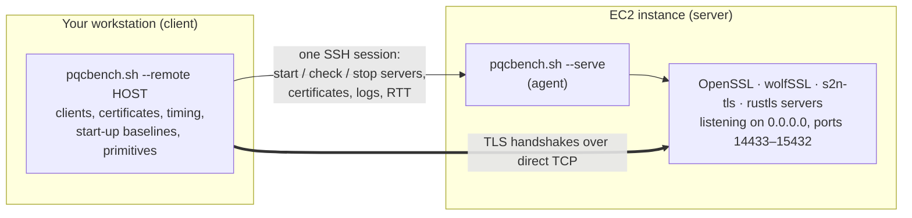

# pqc-bench: post-quantum TLS over a real network

Benchmarks and interoperability tests for post-quantum TLS between **OpenSSL**, **wolfSSL**,
**s2n-tls** and **rustls**, with the TLS servers on one machine (an AWS EC2 instance) and the
clients on another (your workstation), so every handshake crosses a real network path.

It answers four questions:

1. **How fast is each library's post-quantum crypto?** ML-KEM and ML-DSA primitives, with X25519,
   ECDSA/ECDH, Ed25519 and RSA as quantum-vulnerable baselines.
2. **What does a TLS 1.3 handshake cost** in every client → server combination, for pure ML-KEM,
   hybrid and classical key exchange, and for mutual TLS with ML-DSA certificates? Over a real
   path, that includes the round trips, the segment sizes and TCP's congestion window.
3. **Do the libraries interoperate** on ML-DSA keys, signatures and certificates, and on mutual
   TLS, including rejecting what they should reject?
4. **What do TLS version negotiation and downgrade cost?** Mixed TLS 1.2/1.3 setups,
   HelloRetryRequests, refusals, and post-quantum clients that silently end up on classical key
   exchange.

Runs come in two shapes:

- **Split-host** (`pqcbench.sh --remote HOST`): the servers run on HOST and the clients on your
  workstation, so the measurements include a real network path.
- **Loopback** (no `--remote`): everything on one machine. On the server host, this is the baseline
  for its own CPU.

---

## Contents

- [Repository layout](#repository-layout)
- [How split-host mode works](#how-split-host-mode-works)
- [Quick start](#quick-start)
- [The EC2 instance](#the-ec2-instance)
  - [Region](#region)
  - [Instance type](#instance-type)
  - [Operating system image](#operating-system-image)
  - [Storage](#storage)
  - [Network and security group](#network-and-security-group)
  - [Launching with the AWS CLI](#launching-with-the-aws-cli)
  - [SSH access](#ssh-access)
  - [Cost and clean-up](#cost-and-clean-up)
- [Building the libraries (`setup.sh`)](#building-the-libraries-setupsh)
- [Running the benchmarks](#running-the-benchmarks)
  - [A measurement plan](#a-measurement-plan)
  - [Remote runs (`--remote`)](#remote-runs---remote)
  - [Modes](#modes)
  - [Other run options](#other-run-options)
  - [Options and environment reference](#options-and-environment-reference)
  - [What a run produces](#what-a-run-produces)
- [Analysing results (`pqc_analyze.py`)](#analysing-results-pqc_analyzepy)
- [Reading the numbers](#reading-the-numbers)
- [Library notes](#library-notes)
- [Troubleshooting](#troubleshooting)
- [Security notes](#security-notes)
- [Project status](#project-status)

---

## Repository layout

| Path | What it is |
| --- | --- |
| `setup.sh` | Fetches and builds OpenSSL 3.6.5, wolfSSL 5.9.4, AWS-LC 5.10.0, s2n-tls 1.7.10, the rustls tools (one build per crypto provider) and the in-process `hsloop` clients, next to the scripts. `--deps` installs the packages first (apt-get, apk or Homebrew). |
| `pqcbench.sh` | The benchmark and interop checks. Portable POSIX `sh` (dash, bash). `./pqcbench.sh --help` prints the full reference. |
| `libs/{openssl,wolfssl,s2n,rustls}.sh` | One file per library: its servers, clients, speed benchmarks and skip rules, behind a common interface (LIBRARY INTERFACE in `pqcbench.sh`). |
| `hsloop/` | In-process handshake clients (`--inproc`): one driver, one small backend per library. |
| `rustls-tools/` | Cargo workspace: `core/` (the `pqc-rustls` client, server, capabilities and speed tool) and one crate per crypto provider in `providers/`. rustls is pinned at 0.23.45, the toolchain in `rust-toolchain.toml`. |
| `pqc_analyze.py` | Turns runs into comparison tables, CSVs, charts and a Markdown report. Python 3 standard library; matplotlib optional. |
| `VERSION` | Project version, recorded in every run's `env.txt`. |

---

## How split-host mode works



- `pqcbench.sh --remote HOST` logs in to HOST **once** and starts `pqcbench.sh --serve` there, in
  the same checkout on HOST. That **agent** detects HOST's libraries, then starts, checks and stops
  each server as the run goes. It runs the same server functions a loopback run uses.
- **Clients connect to HOST directly**, with no tunnel. Segment sizes, round trips and congestion
  windows are those of the real path. An SSH tunnel would end TCP on your workstation and hide
  exactly what this project measures.
- **Certificates are made on the workstation** and sent to the agent over the SSH session. Every
  client checks the server certificate against the name `localhost` (OpenSSL's `s_client` checks
  the chain only), never against the address, so the certificates are the same as on loopback.
- **Server logs come back** into the run's `logs/`, at the end of the run and immediately when a
  server fails to start. With `--capture`, the servers' TLS secrets come back too, so captures
  decrypt.
- **The round-trip time** is measured at the start and at the end of each run: the median of 15
  request/reply exchanges with the agent over the SSH session. It's recorded in `env.txt`.
- **What stays on the workstation:** the speed benchmarks and the client start-up baselines
  measure the workstation. Run `./pqcbench.sh --primitives-only` on the instance for its CPU.
- **Failure handling:** if the run is interrupted or the SSH connection drops, the agent stops every
  server. It also refuses to start a server on a port that's already in use, so a leftover server
  can't answer in its place.

---

## Quick start

```sh
# 1. Launch an EC2 instance (see "The EC2 instance") and open TCP 22 and 14433-15432 to your IP.

# 2. On the instance: the same checkout as on your workstation, built
git clone https://github.com/<you>/<repo>.git pqc-bench && cd pqc-bench
./setup.sh --deps                      # packages (sudo), then every library
./pqcbench.sh --all --inproc           # loopback baseline on the instance's CPU

# 3. On your workstation (macOS or Linux), in the same checkout
./setup.sh --deps
./pqcbench.sh --remote ubuntu@<instance-ip> --handshakes-only --groups X25519 -n 3   # smoke test
./pqcbench.sh --remote ubuntu@<instance-ip> --all --inproc                           # full run

# 4. Analyse
python3 pqc_analyze.py --markdown      # newest run -> pqcbench-results/<run>/analysis/
```

Use the same commit on both machines. The agent checks its protocol version, and the run warns
when the two `VERSION`/git commits differ.

---

## The EC2 instance

### Region

All resources go in your AWS project's **selected Region**. Confirm it in **AWS Settings → View
all projects → Overview → Additional Info → Region** (or `~/.aws/config` if you can't see that
page), and use it for the key pair, security group and instance. The instance's distance from you
sets the round-trip time you measure: pick the Region you have, then record the RTT the run
measures.

### Instance type

The builds need memory and disk; the benchmark needs **steady** CPU, because the server's
handshake work is part of every measured sample.

| Type | vCPU / memory | Architecture | Free plan¹ | Use |
| --- | --- | --- | --- | --- |
| **c7g.large** | 2 / 4 GiB | arm64 (Graviton) | no | **Recommended for timing.** Fixed performance; same architecture as an Apple-silicon Mac, so both ends run the same ARM64 assembly code paths. |
| c7i.large | 2 / 4 GiB | x86-64 | no | Fixed performance, x86 (wolfSSL builds with `--enable-intelasm`). |
| **m7i-flex.large** | 2 / 8 GiB | x86-64 | yes | **Best free-plan choice:** enough memory for the parallel build. |
| c7i-flex.large | 2 / 4 GiB | x86-64 | yes | Free plan, 4 GiB. |
| t4g.small, t3.small | 2 / 2 GiB | arm64 / x86-64 | yes | Not recommended: build with `./setup.sh -j 1` and swap; burstable CPU credits make timings drift. |
| t4g.micro, t3.micro | 2 / 1 GiB | arm64 / x86-64 | yes | Too small to build. |

¹ For accounts created on or after 15 July 2025, the free plan covers t3.micro, t3.small,
t4g.micro, t4g.small, c7i-flex.large and m7i-flex.large ([EC2 Free Tier
usage](https://docs.aws.amazon.com/AWSEC2/latest/UserGuide/ec2-free-tier-usage.html)). Check your
plan with `aws freetier get-account-plan-state`.

- **Why steady CPU matters:** the build and a long benchmark both keep the CPU busy. Flex
  instances deliver a 40% baseline and can run at full speed 95% of the time over 24 hours, but
  sustained load above the baseline "might see a gradual reduction in the maximum burst CPU
  throughput" ([instance types](https://docs.aws.amazon.com/ec2/latest/instancetypes/instance-types.html)).
  T3/T3a/T4g run in *unlimited* mode by default and bill surplus credits under sustained load;
  launch them with `CpuCredits=standard` if you use them. For numbers you'll publish, use a
  fixed-performance type.
- **Memory:** AWS-LC, OpenSSL and the Rust crates build in parallel. 4 GiB is enough with the
  default `-j` on 2 vCPUs; with 2 GiB, use `./setup.sh -j 1` and add swap. (The out-of-memory risk
  below 4 GiB is inferred, not measured.)
- **Architecture:** either works. `setup.sh` picks wolfSSL's assembly for the CPU, and `env.txt`
  records the host. An arm64 instance needs an arm64 image.

### Operating system image

Use **Ubuntu Server 26.04 LTS** (Canonical's standard image). `setup.sh --deps` installs its
packages with apt-get, and the scripts were tested on Ubuntu 26.04 (under dash, Ubuntu's
`/bin/sh`).

Canonical publishes the image IDs as public SSM parameters
([Find Ubuntu images on AWS](https://documentation.ubuntu.com/aws/aws-how-to/instances/find-ubuntu-images/)):

```
/aws/service/canonical/ubuntu/server/26.04/stable/current/arm64/hvm/ebs-gp3/ami-id   # Graviton
/aws/service/canonical/ubuntu/server/26.04/stable/current/amd64/hvm/ebs-gp3/ami-id   # x86-64
```

**Ubuntu Pro** images add a software fee per vCPU-hour on top of the EC2 price
([Ubuntu Pro for AWS](https://ubuntu.com/aws/pro)). Their extras (expanded security maintenance,
FIPS-certified OS packages, livepatch) don't affect this benchmark, which builds its own
libraries. Use Pro only if your organisation requires it.

### Storage

| What | Size (measured on macOS) |
| --- | --- |
| Build trees: AWS-LC 522 MB, rustls-tools 1 GB, OpenSSL 276 MB, wolfSSL 272 MB, rustls-wolfcrypt 260 MB, s2n-tls 94 MB | ~2.7 GB |
| Rust toolchain and cargo registry | ~4.3 GB |
| Ubuntu itself, packages, results | a few GB |

The image's default root volume (8 GiB) is **too small**. Use **20 GiB or more** of gp3
(30 GiB leaves room for FIPS builds and many runs), and encrypt it.

### Network and security group

Allow inbound only from your workstation's public address (`/32`):

| Port | Protocol | Source | Why |
| --- | --- | --- | --- |
| 22 | TCP | your IP/32 | SSH: the agent's control session |
| 14433–15432 | TCP | your IP/32 | the benchmark servers (`BASE_PORT` 14433 to `BASE_PORT`+999) |

- **Your public address** is what the instance sees: `curl -s https://checkip.amazonaws.com`. Check
  it from the network you'll run on. Behind a VPN or a corporate proxy it's the VPN's or the
  company's egress address, possibly shared with many people.
- **Corporate networks and VPNs** may block outbound connections to ports 14433–15432, and they add
  their own latency to the path you measure. Run from the network whose path you want to measure.
- **If your address changes** (new network, VPN on or off), update both rules, or SSH and every
  handshake will time out.
- **Outbound:** the default "all traffic" rule is needed for `setup.sh`'s downloads.
- **Servers listen on every interface** on the instance during a run. The security group is what
  limits who can reach them; the agent stops them when the run ends.

### Launching with the AWS CLI

The console works just as well. With the CLI (`aws login` first if it has no credentials), from
your workstation:

```sh
REGION=<your selected Region>
MYIP=$(curl -s https://checkip.amazonaws.com)

# key pair (the private key is shown only once)
aws ec2 create-key-pair --region "$REGION" --key-name pqc-bench --key-type ed25519 \
  --query KeyMaterial --output text > ~/.ssh/pqc-bench.pem
chmod 400 ~/.ssh/pqc-bench.pem

# security group in the default VPC: SSH and the benchmark ports, from this address only
SG=$(aws ec2 create-security-group --region "$REGION" --group-name pqc-bench \
  --description "pqc-bench: SSH and benchmark ports from one client" --query GroupId --output text)
aws ec2 authorize-security-group-ingress --region "$REGION" --group-id "$SG" \
  --protocol tcp --port 22 --cidr "$MYIP/32"
aws ec2 authorize-security-group-ingress --region "$REGION" --group-id "$SG" \
  --protocol tcp --port 14433-15432 --cidr "$MYIP/32"

# the instance: Ubuntu 26.04 arm64 on c7g.large, 30 GiB encrypted gp3, IMDSv2 only
ID=$(aws ec2 run-instances --region "$REGION" \
  --image-id resolve:ssm:/aws/service/canonical/ubuntu/server/26.04/stable/current/arm64/hvm/ebs-gp3/ami-id \
  --instance-type c7g.large --key-name pqc-bench --security-group-ids "$SG" \
  --block-device-mappings 'DeviceName=/dev/sda1,Ebs={VolumeSize=30,VolumeType=gp3,Encrypted=true}' \
  --metadata-options HttpTokens=required \
  --tag-specifications 'ResourceType=instance,Tags=[{Key=Name,Value=pqc-bench}]' \
  --query 'Instances[0].InstanceId' --output text)

aws ec2 wait instance-running --region "$REGION" --instance-ids "$ID"
aws ec2 describe-instances --region "$REGION" --instance-ids "$ID" \
  --query 'Reservations[0].Instances[0].PublicIpAddress' --output text
```

- For x86, use the `amd64` parameter and an x86 type (`m7i-flex.large`, `c7i.large`).
- For a T instance, add `--credit-specification CpuCredits=standard`.
- Outside the default VPC, add `--subnet-id` (a public subnet with auto-assigned public IPs) and
  `--vpc-id` for the security group.
- If calls that used to work start failing with *Access Denied*, check whether a spend limit has
  paused the project (**AWS Settings → Billing**).

### SSH access

The default user on Ubuntu images is `ubuntu`. An entry in `~/.ssh/config` keeps the commands
short, and `--remote` uses it (and any other ssh setting) as it is:

```
Host pqc-ec2
    HostName <public IP>
    User ubuntu
    IdentityFile ~/.ssh/pqc-bench.pem
    IdentitiesOnly yes
```

```sh
ssh pqc-ec2 true                       # once: accept the host key
./pqcbench.sh --remote pqc-ec2 ...
```

Without a config entry, `REMOTE_SSH` passes options to ssh:
`REMOTE_SSH="ssh -i ~/.ssh/pqc-bench.pem" ./pqcbench.sh --remote ubuntu@<ip> ...`.

- The clients connect to the `HostName` that `ssh -G` reports, resolved to IPv4 **once** at the
  start, so no client looks up a name inside a timed handshake. Set `REMOTE_ADDR` to override it.
- **A stopped and started instance gets a new public IP** (unless you attach an Elastic IP).
  Update `HostName`.
- **Don't scan or probe port 22.** OpenSSH's PerSourcePenalties refuses later logins from an
  address that opened connections without logging in. That's why the RTT is measured inside the
  SSH session and not with TCP connects.
- **Session Manager** can replace port 22 (`ProxyCommand` with `AWS-StartSSHSession`), but the
  agent's session and the measured RTT then go through Session Manager, not the direct path. The
  benchmark ports must still be open.

### Cost and clean-up

- **Stop the instance between sessions** (`aws ec2 stop-instances`). Its volume is still billed
  while stopped, and a public IPv4 address is billed while in use.
- **When you're done**, terminate the instance and delete the security group and key pair:

  ```sh
  aws ec2 terminate-instances --region "$REGION" --instance-ids "$ID"
  aws ec2 wait instance-terminated --region "$REGION" --instance-ids "$ID"
  aws ec2 delete-security-group --region "$REGION" --group-id "$SG"
  aws ec2 delete-key-pair --region "$REGION" --key-name pqc-bench
  ```

- Data transfer is small: a handshake is a few KB.

---

## Building the libraries (`setup.sh`)

Run it on **both** machines, in the same checkout. The instance's builds serve, and the
workstation's builds are the clients:

```sh
./setup.sh --deps           # install the packages, then fetch and build everything
./setup.sh                  # the same, with the packages already installed
./setup.sh -j 1             # one build job (small instances)
RUSTLS_PROVIDERS=aws-lc-rs ./setup.sh   # rustls with its default provider only (shorter build)
```

| Component | Directory | Version |
| --- | --- | --- |
| `openssl` | `openssl/`, installed to `openssl/openssl-install` | `openssl-3.6.5` |
| `wolfssl` | `wolfssl/` | `v5.9.4-stable` |
| `wolfssl-keylog` (not built by default) | `wolfssl-keylog/` | same as `wolfssl`, plus TLS key logging (decryptable captures only) |
| `aws-lc` | `aws-lc/`, installed to `aws-lc/aws-lc-install` | `v5.10.0` |
| `s2n-tls` | `s2n-tls/` (builds `aws-lc` first) | `v1.7.10` |
| `rustls` | `rustls-tools/bin/pqc-rustls-<provider>` | rustls `0.23.45`, one build per provider in `RUSTLS_PROVIDERS` |
| `hsloop` | `hsloop/bin/` | built from `hsloop/*.c` against the libraries above |

- **Packages:** `--deps` uses `apt-get` (Ubuntu, Debian), `apk` (Alpine) or Homebrew (macOS), with
  `sudo` when you're not root (EC2's `ubuntu` user has passwordless sudo). It installs the
  compilers, CMake, Go (AWS-LC needs it), rustup, GNU coreutils (`timeout`), `ss` and `tcpdump`.
  `--deps-only` stops after the packages.
- **Existing trees are kept:** a built component is skipped. `--rebuild` rebuilds it from a clean
  build tree; delete its directory to fetch another version.
- **Logs:** each component writes `<component>/pqc-setup.log`; on failure the script prints the end
  of it.
- **The tags** (`OPENSSL_REF`, `WOLFSSL_REF`, `AWSLC_REF`, `S2N_REF`) are the tested releases. A
  newer s2n-tls can rename security policies the script uses.
- **Behind a TLS-inspecting proxy**, set `EXTRA_CA_FILE` to the proxy's root CA (PEM).
- **FIPS builds:** `./setup.sh --fips` builds FIPS-mode variants next to the regular ones (see
  [FIPS mode](#fips-mode---fips)).
- **macOS:** if the compiler fails because the SDK targets a newer macOS than you run, export an
  older `SDKROOT` before building and before running `pqcbench.sh`.
- `./setup.sh --help` lists every option and environment variable.

---

## Running the benchmarks

### A measurement plan

1. **Loopback baseline on the instance:** `./pqcbench.sh --all --inproc` on the instance. Its CPU
   differs from your workstation's, so this, not a workstation run, is the baseline that remote
   results are compared with.
2. **Smoke test from the workstation:**
   `./pqcbench.sh --remote pqc-ec2 --handshakes-only --groups X25519 -n 3`. It should time every
   pair; failures here are network or build problems ([Troubleshooting](#troubleshooting)).
3. **Remote runs:** `./pqcbench.sh --remote pqc-ec2 --all --inproc`. Repeat at different times of
   day: internet round trips vary, and pooled runs give steadier medians.
4. **One capture run**, separately: `./pqcbench.sh --remote pqc-ec2 --mlkem --mldsa --capture`. It
   shows flight sizes, segments and extra round trips on the real path. Don't take timing from
   capture runs (they log keys on every handshake).
5. **Analyse** the remote runs together (`python3 pqc_analyze.py RUN1 RUN2 RUN3 --markdown`), and
   the instance's loopback run on its own.

### Remote runs (`--remote`)

```sh
./pqcbench.sh --remote [USER@]HOST [options]
```

- **HOST** is anything `ssh` accepts: an address, a name, or a `~/.ssh/config` alias.
- **`REMOTE_DIR`** is the checkout on HOST (default `pqc-bench`, relative to the remote home; no
  spaces). The agent runs `cd $REMOTE_DIR && sh ./pqcbench.sh --serve …` there.
- **Libraries:** every library the run tests here must have a server on HOST. `--no-s2n`,
  `--no-rustls`, `--rustls-provider` and `--fips` are passed to the agent, so both ends agree. The
  run stops if HOST lacks a library.
- **Iterations:** every sample costs several real round trips, so the defaults drop to **20 / 10 / 5**
  (key exchange / ML-DSA / versions). `-n`, `--mldsa-iterations` and
  `--versions-iterations` override them.
- **Timeouts:** `HS_TIMEOUT` rises to at least 50 round trips. After a failed handshake, the next
  server check waits one round trip, because a server that exits after a refused handshake only
  learns of the refusal half a round trip after the client.
- **Ports:** a run uses at most 1000 server ports (`BASE_PORT`..`BASE_PORT`+999, the range the
  security group allows); one per library for each group, ML-DSA chain and versions scenario, so
  even an `--all` run with every rustls provider stays well inside it.
- **Capture:** `--capture` runs tcpdump on the workstation, on the interface the route to HOST
  leaves by (`CAPTURE_IFACE` overrides it), filtered to HOST's address.

Roughly, a per-process sample costs the client's start-up (10–35 ms on an Apple M-series Mac)
plus about three round trips (TCP connect, TLS 1.3 handshake, request and response). A key-exchange
pair costs (`WARMUP` + iterations) of those. Multiply by the pairs (up to 16 with four libraries)
and the groups (9 by default) to estimate a run.

### Modes

| Mode | Flag | What it does |
| --- | --- | --- |
| Key exchange | `--mlkem` (default) | Primitive benchmarks for ML-KEM, X25519, ECDH and RSA, then every client → server pair timed for each group: `X25519 P-256 P-384`, `MLKEM512 MLKEM768 MLKEM1024`, `X25519MLKEM768 SecP256r1MLKEM768 SecP384r1MLKEM1024`. The server certificate is the same for every pair (ECDSA P-256 unless `--cert`). |
| ML-DSA | `--mldsa` | ML-DSA primitives; key, signature and certificate interop between OpenSSL and wolfSSL; mutual TLS with ML-DSA chains in every direction (profiles `44 65 87 87-44`), timed; negative tests (missing client certificate, untrusted chain). |
| Versions | `--versions` | 16 scenarios of TLS version and group (mis)matches in every direction: outcome checked (PASS/FAIL), HelloRetryRequest and "PQ lost" flagged, then timed (time to refusal for refused cases). |
| All | `--all` | All three. Mode flags also combine (`--mlkem --mldsa`). |

- Each pair gets a **preflight** handshake first, which confirms the negotiated group where the
  client reports it.
- Pairs that can't pin a group are **skipped with the reason**: the wolfSSL example client has no
  flag for `P-384`; s2n-tls lacks `MLKEM512`/`MLKEM768` and pins groups only through built-in
  policies; some rustls providers lack post-quantum groups.
- **Exit status** is 1 if any ML-DSA interop check or versions-mode case failed (usable in CI).

### Other run options

| Option | What it adds |
| --- | --- |
| `--inproc` | Also times each key-exchange and mutual-TLS pair with an hsloop client: all of a pair's handshakes in one process, so process and library start-up are measured once (`init_ms`), and each sample is split into **connect / handshake / response / close**. Over a real path, the connect phase is one round trip. Recommended for remote runs. |
| `--capture` | One pcap per checked handshake (never for timed runs), with TLS secrets embedded (`editcap`) and a decoded transcript (`tshark`) when Wireshark's tools are installed. Needs capture permission (macOS: Wireshark's ChmodBPF; Linux: `sudo` or `setcap` on tcpdump). In Wireshark, set Preferences → Protocols → HTTP → SSL/TLS Ports to `14433-15432`. wolfSSL → wolfSSL connections decrypt only with `./setup.sh wolfssl-keylog` and `WOLFSSL_DIR=./wolfssl-keylog`. |
| `--cert "ec mldsa65 mldsa87-44"` | Times the key-exchange matrix once per server certificate (`ec`, `mldsa44`, `mldsa65`, `mldsa87`, `mldsa<CA>-<leaf>`, or `all`); `--cert-issuer wolfssl` has wolfSSL issue them. Over a real path, larger ML-DSA chains can cross TCP's initial window (10 segments) and cost an extra round trip. |
| `--pure-pq` | Pure ML-KEM wherever a pair supports it, with recorded fallbacks to hybrid, then classical. |
| `--rustls-provider P` | rustls's crypto provider (`aws-lc-rs` default; a list or `all` runs several side by side). |
| <a id="fips-mode---fips"></a>`--fips` | The FIPS builds from `./setup.sh --fips`, FIPS-approved algorithms only (no X25519; versions mode skipped). With `--remote`, both machines need FIPS builds. These run FIPS module code in FIPS mode; they are **not CMVP-validated modules**. |
| `--primitives-only` / `--handshakes-only` | Only the speed benchmarks / skip them. |
| `--groups "…"`, `--mldsa-profiles "…"`, `--versions-scenarios "…"` | Subsets. |

### Options and environment reference

`./pqcbench.sh --help` prints the complete reference. The ones you'll use most:

| Option | Default | |
| --- | --- | --- |
| `--remote [USER@]HOST` | off | Servers on HOST (see above). |
| `-n`, `--iterations N` | 100 (20 with `--remote`) | Timed handshakes per pair, key-exchange mode. |
| `--mldsa-iterations N` | 20 (10 with `--remote`) | Timed mutual-TLS handshakes per pair (0 = checks only). |
| `--versions-iterations N` | 20 (5 with `--remote`) | Timed runs per versions case (0 = outcome checks only). |
| `--groups "…"` | all nine | Key-exchange groups. |
| `--no-s2n`, `--no-rustls` | | Leave a library out. |

| Environment | Default | |
| --- | --- | --- |
| `REMOTE_DIR` | `pqc-bench` | `--remote`: the checkout on HOST (relative to its home). |
| `REMOTE_ADDR` | `ssh -G`'s HostName | `--remote`: the address clients connect to (resolved to IPv4 once). |
| `REMOTE_SSH` | `ssh` | `--remote`: the ssh command, e.g. `ssh -i ~/.ssh/key.pem`. |
| `BASE_PORT` | 14433 | First server port. |
| `WARMUP` | 5 | Untimed handshakes before each timed series. |
| `HS_TIMEOUT` | 10 | Per-handshake timeout in seconds (raised automatically for long RTTs). |
| `SPEED_SECONDS` | 3 | Seconds per primitive benchmark. |
| `MLDSA_GROUP` | `MLKEM768` | Key exchange for ML-DSA-mode handshakes (`X25519MLKEM768` brings s2n-tls in). |
| `RESULTS_DIR` / `OUTDIR` | `./pqcbench-results` / `<RESULTS_DIR>/<timestamp>` | Where runs go. |
| `OPENSSL`, `WOLFSSL_DIR`, `S2N_DIR`, `BSSL`, `HSLOOP_DIR`, `RUSTLS_BIN` | the trees `setup.sh` built | Use builds elsewhere. |
| `CAPTURE_IFACE`, `CAPTURE_TOOL` | route to HOST (`--remote`) or loopback; `tcpdump` | Capture settings. |

### What a run produces

On the workstation, each run gets its own directory:

```
pqcbench-results/20261020-142233/
├── env.txt                        versions, settings, host; with --remote also "remote …" lines
│                                  (the instance's env.txt), "remote:" (servers, address, RTT at the
│                                  start) and "remote end:" (RTT at the end)
├── handshakes_raw.csv             key exchange: one row per timed handshake (group, cert, client, server, ms)
├── handshakes_summary.csv         per group, certificate and pair: n, min, median, mean, p95, max,
│                                  adj_median (minus client start-up), failures, restarts, note
├── handshakes_inproc_*.csv        --inproc: per-handshake phase times; per-pair summaries with init_ms
├── mldsa_interop.csv              one row per interop check (PASS/FAIL/SKIP and the reason)
├── mldsa_handshakes_*.csv         mutual TLS timings (and --inproc variants)
├── versions_results.csv           one row per versions case: outcome, version, group, HRR, PQ lost, round trips
├── versions_handshakes_*.csv      versions timings
├── primitives/                    raw speed output (this machine)
├── captures/                      --capture: <mode>/…/<client>-to-<server>.pcapng (+ .txt), index.csv
├── certs/  mldsa/  versions/      generated keys and certificates
├── tools/                         helper programs and working files (tools/remote/: the agent's FIFOs)
└── logs/                          preflights, interop checks, client logs; server-*.log (with
                                   --remote, fetched from the instance); remote-agent.log (the agent's
                                   own output)
```

On the instance, the agent keeps its side of each remote run in
`~/pqc-bench/pqcbench-results/<run>-servers/`: its `env.txt`, the server logs, the certificates it
received and, with `--capture`, the servers' key logs. `pqcbench-results/` is git-ignored on both
machines.

---

## Analysing results (`pqc_analyze.py`)

```sh
python3 pqc_analyze.py                                   # newest run in ./pqcbench-results
python3 pqc_analyze.py pqcbench-results/20261020-142233  # one run
python3 pqc_analyze.py RUN1 RUN2 RUN3                    # pool repeated runs
python3 pqc_analyze.py RUN1 RUN2 --markdown summary.md   # formatted report
```

| Option | |
| --- | --- |
| `--out DIR` | Output directory (default `<first run>/analysis`). |
| `--bootstrap N` | Resamples for the 95% confidence intervals (default 2000; 0 = off). |
| `--no-plots` | Skip charts (skipped automatically without matplotlib: `pip install matplotlib`). |
| `--all-primitives` | Also list operations only one library measured. |
| `--rtt MS` | Project versions-mode timings onto a link with this RTT. Ignored for `--remote` runs, which already crossed a real path. |
| `--markdown [FILE]` | A formatted report: contents, "At a glance" findings, a Test setup table with every `env.txt` setting per run (the instance's `remote …` lines included), charts, and folded detail tables. |

What it reports:

- **Primitives:** operations matched across libraries (ops/s, µs per operation, ratio against
  OpenSSL). From a remote run these describe the workstation.
- **Handshakes by direction:** median, IQR and p95 for every client → server direction and
  measurement; ratios against OpenSSL → OpenSSL with bootstrap confidence intervals; and for each
  pair of libraries a 2×2 breakdown into **client effect**, **server effect** and **interop
  penalty**.
- **In-process timing** (`--inproc`): `init_ms` next to the start-up baseline, per-direction
  medians, and how much one process per handshake adds.
- **Round trips on the network path** (`--remote` runs): each library with itself, in process
  (whole sample, and connect / handshake / response) and per process (median minus start-up), **in
  round trips of the measured RTT** (start and end averaged). Also written to `round_trips.csv`.
  A sample has the connect (1), the handshake (1) and the request and response (1 or more); extra
  round trips come from a HelloRetryRequest, a flight larger than TCP's initial window, or a
  program that writes in small pieces and waits for acknowledgements.
- **Versions:** the outcome of every scenario and direction, and what negotiation, downgrade,
  HelloRetryRequest, ML-DSA certificates and refusal cost, with confidence intervals.
- **Captures** (`--capture`): bytes and TCP segments per flight, ClientHello and key-share sizes,
  negotiated version and group, alerts, and extra round trips counted from the packets; sizes by
  group, certificate and ML-DSA profile.

Output files: `report.md`, `primitives_comparison.csv`, `handshake_directions.csv`,
`handshake_effects.csv`, `versions_comparisons.csv`, `captures_summary.csv`,
`inproc_comparison.csv`, `cert_costs.csv`, `round_trips.csv`, charts (`*.png`), and with
`--markdown`, `results.md`.

**Pooling:** pool runs made against the same servers from the same network. The analyser warns
when the pooled runs mix network paths (remote and loopback, or different instances), FIPS and
regular builds, or certificate issuers.

---

## Reading the numbers

- **Remote handshake times include the path.** `adj_median_ms` (median minus the client's start-up
  baseline) is roughly three round trips plus the two sides' crypto and processing. Compare
  libraries within one run, or runs with similar measured RTTs.
- **Express times in round trips.** The "Round trips on the network path" table divides by the
  measured RTT. Differences of a whole round trip mean protocol behaviour: a HelloRetryRequest, or
  a flight that didn't fit TCP's initial window. Fractions of a round trip are computation and
  jitter.
- **Watch the RTT drift.** `env.txt`'s `remote:` and `remote end:` lines give the RTT at the start
  and end. A large change means the path changed during the run; repeat it.
- **Internet jitter widens the spread.** Use medians and p95, pool repeated runs, and give the
  analyser's confidence intervals more weight than single medians.
- **Use the in-process numbers for the handshake itself.** Per-process samples are dominated by
  process start-up (10–35 ms per client on the test machine); hsloop's connect phase also gives
  you a per-sample RTT.
- **Start-up baselines and primitives are the workstation's.** The server's crypto speed is in the
  instance's own loopback run (or `--primitives-only` there).
- **AWS-LC seeds its RNG from CPU jitter** by default, ~17 ms per s2n-tls client process (and
  ~20 ms for rustls on aws-lc-rs) on an Apple M-series Mac, which the baseline only partly
  removes. `./setup.sh --awslc-no-jitter` builds AWS-LC without it, for benchmarking only.
- **Every handshake is a fresh connection** with no session resumption; the per-process clients
  are also fresh processes.
- **Build options matter as much as the library.** wolfSSL is built with its fast math and assembly
  (`--enable-sp --enable-sp-asm` and the CPU's assembly flag); see [Library notes](#library-notes).
- **Primitive benchmarks are single runs**: raise `SPEED_SECONDS` or pool runs for steadier
  figures.

---

## Library notes

**wolfSSL** is built by `setup.sh` with:

```sh
./configure --enable-mlkem --enable-mldsa --enable-curve25519 --enable-ed25519 \
            --enable-tls13 --enable-tls-mlkem-standalone \
            --enable-certgen --enable-certext --enable-keygen \
            --enable-sp --enable-sp-asm --enable-armasm \
            --disable-shared CPPFLAGS=-DWOLFSSL_ALT_NAMES      # --enable-intelasm on x86-64
```

| Option | Why |
| --- | --- |
| `--enable-tls-mlkem-standalone` | Pure `MLKEM512/768/1024` TLS groups; without it only hybrids work. |
| `--enable-certgen --enable-certext` | wolfSSL issues its own ML-DSA certificates for the interop checks. |
| `CPPFLAGS=-DWOLFSSL_ALT_NAMES` | wolfSSL-issued leaves get a subjectAltName; rustls checks only that. |
| `--enable-sp --enable-sp-asm`, `--enable-armasm`/`--enable-intelasm` | Optimised math and assembly (ML-KEM, ML-DSA, SHA-2/3, EC, RSA). Without them wolfSSL looks many times slower than it is. |
| `--disable-shared` | Static programs, so no libtool wrapper start-up lands in the timings. |

**s2n-tls** has no group or version flags: `s2nc` and `s2nd` take everything from named security
policies (the POLICY TABLE in `libs/s2n.sh`; `s2n-tls/build/bin/policy NAME` shows one). It doesn't
implement `MLKEM512` or `MLKEM768`, and some policies send a second key share, which the summaries
note. It runs with an empty default trust store, so it loads only the CA it's given.

**rustls** has no crypto of its own; `--rustls-provider` picks one:

| Provider | Post-quantum key exchange | ML-DSA |
| --- | --- | --- |
| `aws-lc-rs` (default) | X25519MLKEM768, SecP256r1MLKEM768, MLKEM768, MLKEM1024 | 44, 65, 87 |
| `ring`, `rustcrypto`, `wolfcrypt` | none | none |
| `graviola` | X25519MLKEM768 | none |
| `graviola-pq` | X25519MLKEM768, SecP256r1MLKEM768, MLKEM768 | none |
| `rustcrypto-pq`, `libcrux-pq` | every hybrid and pure ML-KEM group | 44, 65, 87 |

`pqc-rustls caps` lists what a build has; pairs needing anything else are skipped with the reason.
`graviola-pq`, `rustcrypto-pq` and `libcrux-pq` are this project's providers, published on
crates.io. `wolfcrypt` is GPL-3.0 and is fetched and patched by `setup.sh`.

---

## Troubleshooting

**Remote runs**

| Symptom | Cause and fix |
| --- | --- |
| `--remote: lost the connection to HOST's agent` right at the start | The agent didn't start. The message quotes `logs/remote-agent.log`: `cd: can't cd` (wrong `REMOTE_DIR`), `Permission denied (publickey)` (key or user), `Host key verification failed` (run `ssh HOST true` once), `unknown option: --serve` (HOST's checkout predates split-host mode). |
| `… lost the connection …` mid-run | The SSH session dropped (network change, sleep, VPN). The agent stops its servers; run again. |
| `HOST has no s2n server` (or rustls, …) | That library isn't built on HOST: `./setup.sh` there, or `--no-s2n` / `--rustls-provider` here. |
| `HOST's pqcbench.sh speaks agent protocol …` | The two checkouts differ: update HOST's (`git pull`). |
| Warning `HOST runs pqc-bench X, this machine Y` | Different commits or uncommitted changes on one side. Use the same commit for results you keep. |
| Every preflight fails with `handshake failed`, after timeouts | The benchmark ports aren't reachable: check the security group's 14433–15432 rule, your current public address (`curl -s https://checkip.amazonaws.com`), and whether your network blocks those ports. On HOST, `ss -ltn` during a run shows the listening servers. |
| `server on HOST didn't start …: port N is already in use` | A leftover server from an agent that was killed outright. On HOST: `ss -ltnp \| grep -E ':1[45][0-9]{3} '`, then stop it (`pkill -f 'pqcbench.sh --serve'`, or the server by its PID). |
| Only the pairs with a rustls server fail, and its log in `logs/server-rustls-*.log` says `listening on 127.0.0.1:…` | HOST's `pqc-rustls` predates `--bind` (older builds ignore the option): `./setup.sh rustls` there. |
| `can't resolve NAME to an IPv4 address` | No IPv4 address for HostName, or no perl/python3 here: set `REMOTE_ADDR` to the instance's IPv4 address. |
| `couldn't time the round trip` | perl and python3 are both missing on the workstation. |
| SSH refused after many attempts | OpenSSH penalises addresses that open connections without logging in. Wait for the penalty to expire, and don't probe port 22. |
| SSH times out | Security group (your address changed?), or the instance's public IP changed after a stop/start. |
| AWS calls suddenly fail with *Access Denied* | A spend limit may have paused the project: check **AWS Settings → Billing**. |
| `--capture: no route to … found` | Set `CAPTURE_IFACE` to the interface towards the instance (`route -n get <ip>` on macOS, `ip route get <ip>` on Linux). |

**General**

| Symptom | Cause and fix |
| --- | --- |
| `preflight failed (wolfSSL client build lacks this group)` on `MLKEM*` | wolfSSL without `--enable-tls-mlkem-standalone`: `./setup.sh --rebuild wolfssl`. |
| `wolf root not found` | The wolfSSL examples must run from their source tree: set `WOLFSSL_DIR` to it. |
| `ML-KEM and ML-DSA need OpenSSL 3.5+` | `./setup.sh openssl`, or point `OPENSSL` at a 3.5+ binary. |
| A hung handshake stalls the run | Install `timeout` (macOS: `brew install coreutils`). |
| `cannot capture on …` | No capture permission: macOS, Wireshark's ChmodBPF; Linux, `sudo` or `setcap cap_net_raw,cap_net_admin=eip "$(command -v tcpdump)"`. |
| Wireshark shows TCP but no TLS | Preferences → Protocols → HTTP → SSL/TLS Ports: `14433-15432`. |
| ML-DSA mode: `SKIP … s2n-tls doesn't implement MLKEM768` | Use `MLDSA_GROUP=X25519MLKEM768`, or `--pure-pq` to give s2n-tls pairs a noted fallback. |
| s2n server log: `Error setting cipher prefs` | That s2n-tls build lacks a policy the script uses: build the tested release, or compare `libs/s2n.sh`'s POLICY TABLE with `s2n-tls/build/bin/policy NAME`. |
| `rustls (…) not found … leaving it out` | `./setup.sh rustls` (needs rustup). |
| `setup.sh`: `SSL certificate problem` | A TLS-inspecting proxy: set `EXTRA_CA_FILE` to its root CA. |
| `setup.sh`: `Go not found` | AWS-LC needs Go 1.20+: `./setup.sh --deps`. |
| `cut: … Illegal byte sequence` at start-up (macOS) | Harmless: a byte check on binary files under a UTF-8 locale. |

---

## Security notes

- **Exposure:** the security group is what keeps the benchmark servers private. Allow your `/32`
  only, and delete the rules when you're done. The servers run only during a run.
- **Test credentials only:** every certificate and key is generated per run, valid for 30 days,
  and named `localhost`. Never reuse them. `.gitignore` excludes `pqcbench-results/` (and with it
  every generated key) but not `*.pem`/`*.key` in general, so check what you commit.
- **Key logging:** capture runs write TLS secrets to disk on both machines, and the
  `wolfssl-keylog` build writes them on every handshake. Keep them out of timing runs and out of
  production.
- **The agent** runs a fixed set of requests (start, check and stop servers; store files inside its
  run directory). It runs with the rights of the SSH user, who can already do anything the agent
  can.
- **Instance hygiene:** IMDSv2 required (as in the launch example), encrypted volume, nothing else
  listening, terminated when done.

---

## Project status

- Loopback runs (no `--remote`) were tested on macOS with all four libraries, 0 failures.
- Split-host mode was tested from a macOS workstation in two ways:
  - **Against an agent on the same Mac:** all three modes, `--inproc --capture`, all four libraries,
    0 failures.
  - **Against an Ubuntu 26.04 host over real SSH:** all modes without rustls, 0 failures.

  Both tests also covered the failure paths: a port in use, interruption, and a dropped SSH
  session.
- **Not yet run against EC2 itself.** The first real run is the [smoke test](#a-measurement-plan).
- MIT licensed (`LICENSE`), as is the Cargo workspace. wolfSSL and the wolfcrypt rustls provider
  are GPL-3.0 and are fetched at build time, not included here.
